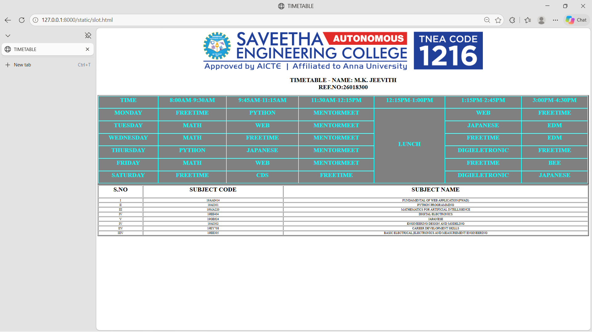

# Ex04 Time Table
## Date:16/11/2026

## AIM
To write a html webpage page to display your slot timetable.

## ALGORITHM
### STEP 1
Create a Django-admin Interface.

### STEP 2
Create an App inside the Django project.

### STEP 2
Create a static folder uder the created App and insert HTML code.

### STEP 3
Create a simple table using ```<table>``` tag in html with the relevant attributes.

### STEP 4
Add rows using ```<tr>``` tag.

### STEP 5
Add your course schedule using ```<td>``` tag.

### STEP 6
Execute the program using runserver command.

## PROGRAM
```
<html>
    <head>
        <title>
            TIMETABLE
        </title>
    </head>
    <body>
        
        <table border="5">
            <caption><h1>TIMETABLE - NAME: M.K. JEEVITH<br>REF.NO:26018300</h1></caption>
            <tr>
                <th bgcolor="grey" style="color:aqua" align="center"><b><h1>TIME</h1></b></th>
                <th bgcolor="grey" style="color:aqua" align="center"><b><h1>8:00AM-9:30AM</h1></b></th>
                <th bgcolor="grey" style="color:aqua" align="center"><b><h1>9:45AM-11:15AM</h1></b></th>
                <th bgcolor="grey" style="color:aqua" align="center"><b><h1>11:30AM-12:15PM</h1></b></th>
                <th bgcolor="grey" style="color:aqua" align="center"><b><h1>12:15PM-1:00PM</h1></b></th>
                <th bgcolor="grey" style="color:aqua" align="center"><b><h1>1:15PM-2:45PM</h1></b></th>
                <th bgcolor="grey" style="color:aqua" align="center"><b><h1>3:00PM-4:30PM</h1></b></th>
            </tr>
            <tr>
                <td bgcolor="grey" style="color: aqua" align="center"><h1>MONDAY</h1></td>
                <td bgcolor="grey" style="color: aqua" align="center"><h1>FREETIME</h1></td>
                <td bgcolor="grey" style="color: aqua" align="center"><h1>PYTHON</h1></td>
                <td bgcolor="grey" style="color: aqua" align="center"><h1>MENTORMEET</h1></td>
                <td bgcolor="grey" style="color: aqua" align="center"><h1>LUNCH</h1></td>
                <td bgcolor="grey" style="color: aqua" align="center"><h1>WEB</h1></td>
                <td bgcolor="grey" style="color: aqua" align="center"><h1>FREETIME</h1></td>
            </tr>
            <tr>
                <td bgcolor="grey" style="color: aqua" align="center"><h1>TUESDAY</h1></td>
                <td bgcolor="grey" style="color: aqua" align="center"><h1>MATH</h1></td>
                <td bgcolor="grey" style="color: aqua" align="center"><h1>WEB</h1></td>
                <td bgcolor="grey" style="color: aqua" align="center"><h1>MENTORMEET</h1></td>
                <td bgcolor="grey" style="color: aqua" align="center"><h1>LUNCH</h1></td>
                <td bgcolor="grey" style="color: aqua" align="center"><h1>JAPANESE</h1></td>
                <td bgcolor="grey" style="color: aqua" align="center"><h1>EDM</h1></td>
            </tr>
            <tr>
                <td bgcolor="grey" style="color: aqua" align="center"><h1>WEDNESDAY</h1></td>
                <td bgcolor="grey" style="color: aqua" align="center"><h1>MATH</h1></td>
                <td bgcolor="grey" style="color: aqua" align="center"><h1>FREETIME</h1></td>
                <td bgcolor="grey" style="color: aqua" align="center"><h1>MENTORMEET</h1></td>
                <td bgcolor="grey" style="color: aqua" align="center"><h1>LUNCH</h1></td>
                <td bgcolor="grey" style="color: aqua" align="center"><h1>FREETIME</h1></td>
                <td bgcolor="grey" style="color: aqua" align="center"><h1>EDM</h1></td>
            </tr>
            <tr>
                <td bgcolor="grey" style="color: aqua" align="center"><h1>THURSDAY</h1></td>
                <td bgcolor="grey" style="color: aqua" align="center"><h1>PYTHON</h1></td>
                <td bgcolor="grey" style="color: aqua" align="center"><h1>JAPANESE</h1></td>
                <td bgcolor="grey" style="color: aqua" align="center"><h1>MENTORMEET</h1></td>
                <td bgcolor="grey" style="color: aqua" align="center"><h1>LUNCH</h1></td>
                <td bgcolor="grey" style="color: aqua" align="center"><h1>DIGIELETRONIC</h1></td>
                <td bgcolor="grey" style="color: aqua" align="center"><h1>FREETIME</h1></td>
            </tr>
            <tr>
                <td bgcolor="grey" style="color: aqua" align="center"><h1>FRIDAY</h1></td>
                <td bgcolor="grey" style="color: aqua" align="center"><h1>MATH</h1></td>
                <td bgcolor="grey" style="color: aqua" align="center"><h1>WEB</h1></td>
                <td bgcolor="grey" style="color: aqua" align="center"><h1>MENTORMEET</h1></td>
                <td bgcolor="grey" style="color: aqua" align="center"><h1>LUNCH</h1></td>
                <td bgcolor="grey" style="color: aqua" align="center"><h1>FREETIME</h1></td>
                <td bgcolor="grey" style="color: aqua" align="center"><h1>BEE</h1></td> 
            </tr>
            <tr>
                <td bgcolor="grey" style="color: aqua" align="center"><h1>SATURDAY</h1></td>
                <td bgcolor="grey" style="color: aqua" align="center"><h1>FREETIME</h1></td>
                <td bgcolor="grey" style="color: aqua"align="center"><h1>CDS</h1></td>
                <td bgcolor="grey" style="color: aqua" align="center"><h1>FREETIME</h1></td>
                <td bgcolor="grey" style="color: aqua" align="center"><h1>LUNCH</h1></td>
                <td bgcolor="grey" style="color: aqua" align="center"><h1>DIGIELETRONIC</h1></td>
                <td bgcolor="grey" style="color: aqua" align="center"><h1>JAPANESE</h1></td>
            </tr>
        </table>
        <table border="3" align="center">
            <tr>
                <th align="center"><h1>S.NO</h1></th>
                <th align="center"><h1>SUBJECT CODE</h1></th>
                <th align="center"><h1>SUBJECT NAME</h1></th>
            </tr>
            <tr>
                <td align="center">I</td>
                <td align="center">19AAI414</td>
                <td align="center">FUNDAMENTAL OF WEB APPLICATION(FWAD)</td>
            </tr>
            <tr>
                <td align="center">II</td>
                <td align="center">19AI301</td>
                <td align="center">PYTHON PROGRAMMING</td>
            </tr>
            <tr>
                <td align="center">III</td>
                <td align="center">19MA220</td>
                <td align="center">MATHEMATICS FOR ARTIFICIAL INTELLIGENCE</td>
            </tr>
            <td align="center">IV</td>
            <td align="center">19EE404</td>
            <td align="center">DIGITAL ELECTRONICS</td>
            <tr>
                <td align="center">V</td>
                <td align="center">19GE624</td>
                <td align="center">JAPANESE</td>
            </tr>
            <tr>
                <td align="center">IV</td>
                <td align="center">19AI302</td>
                <td align="center">ENGINEERING DESIGN AND MODELING</td>
            </tr>
            <tr>
                <td align="center">IIV</td>
                <td align="center">19EY708</td>
                <td align="center">CAREER DEVELOPMENT SKILLS</td>
            </tr>
            <tr>
                <td align="center">IIIV</td>
                <td align="center">19EE305</td>
                <td align="center">BASIC ELECTRICAL,ELECTRONICS AND MEASUREMENT ENGINEERING</td>
            </tr>
        </table>
    </body>

</html>
```

## OUTPUT


## RESULT
The program for creating slot timetable using basic HTML tags is executed successfully.
